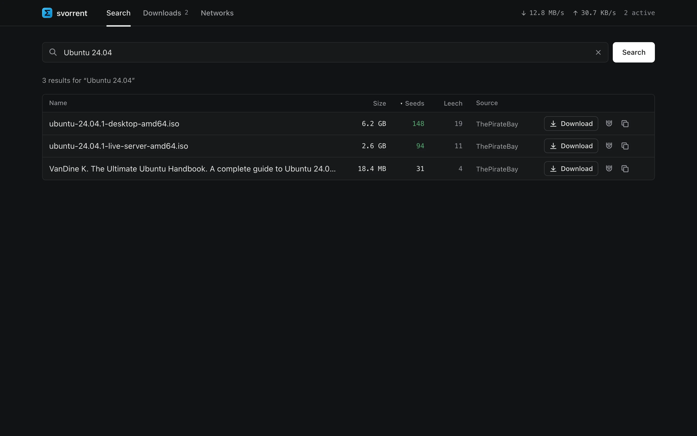
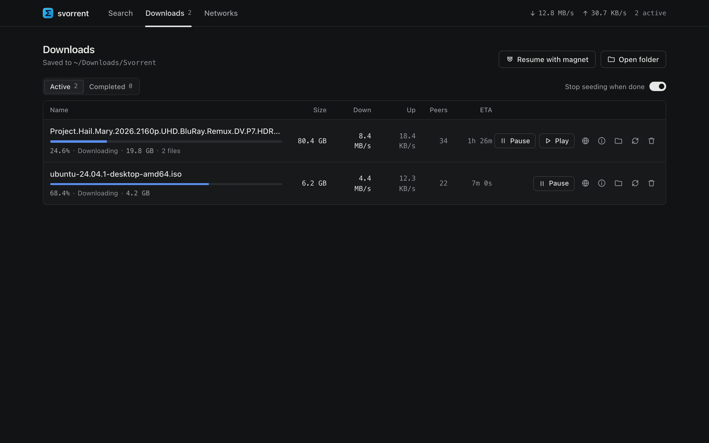
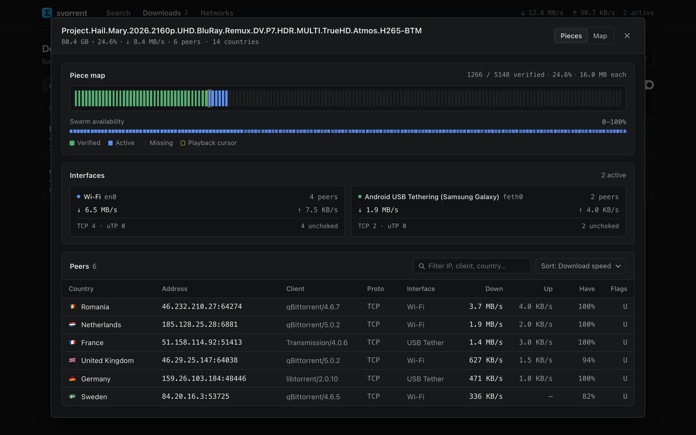
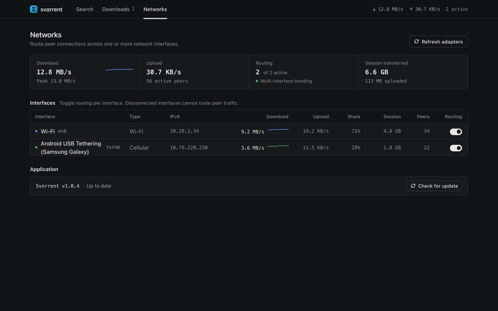
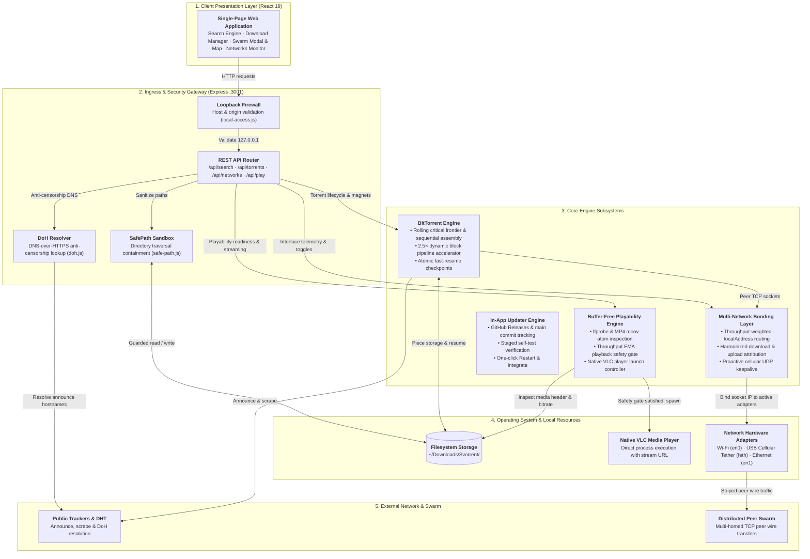

<p align="center">
  
</p>

<h1 align="center">Svorrent</h1>

<p align="center">
  <b>A desktop BitTorrent client with search, downloads, local media playback, and network and peer diagnostics.</b>
</p>

<p align="center">
  <a href="https://github.com/sovopr/svorrent/actions/workflows/ci.yml"></a>
  <a href="https://github.com/sovopr/svorrent/releases/latest"></a>
  <a href="https://github.com/sovopr/svorrent/releases"></a>
  <a href="LICENSE"></a>
</p>

---

## Downloads (v1.0.4)

Svorrent uses a local web interface. Desktop launchers start the backend and open the interface in your default browser. Node.js 22.12 or newer is required; the current packages do not bundle it.

| Platform | Package | Size | Description |
| :--- | :--- | :--- | :--- |
| **Android (ARM64 / ARMv7 / x86_64)** | [**`Svorrent.apk`**](https://github.com/sovopr/svorrent/releases/latest/download/Svorrent.apk) | 47.3 MB | Native Android app with simultaneous Wi-Fi + Mobile Data (5G/LTE) bonding and background downloads. |
| **Windows (x64)** | [**`Svorrent-Setup.exe`**](https://github.com/sovopr/svorrent/releases/latest/download/Svorrent-Setup.exe) | 23.3 MB | Installer with Desktop & Start Menu shortcuts. |
| **macOS (Apple Silicon)** | [**`Svorrent.dmg`**](https://github.com/sovopr/svorrent/releases/latest/download/Svorrent.dmg) | 19.0 MB | Native Apple Silicon disk image. Drag `Svorrent.app` into `/Applications`. |

The macOS package is arm64-only; an Intel Mac build is not currently available.
The Android package is a standalone native app (Jetpack Compose + libtorrent C++ engine) featuring simultaneous multi-network bonding across Wi-Fi and Mobile Data (5G/LTE), background foreground service downloading, and direct in-app updates.
Releases include `SHA256SUMS.txt` and support SHA-256-verified in-app updates from GitHub Releases as well as continuous repository code integration from `main` (staged self-testing via `node --check` and the unit test suite before prompting **Restart & Integrate** on macOS and Windows).

---

## Features & Interface Workflow

### 1. Torrent Search
The search interface queries The Pirate Bay with a bounded request timeout and DNS-over-HTTPS (DoH) fallback.
- Queries are deduplicated, normalized, and sortable by seeds, leechers, file size, or indexer source.
- Magnets launch directly into the download pipeline with a single click.



### 2. Downloads Manager & Streaming Controls
The downloads dashboard manages active and completed transfers, supports an **Auto-stop seeding** toggle directly in the header, and can open a playable local video in VLC or your system's default media player.



#### 2.1 Sequential Piece Scheduling, Swarm Pipeline Acceleration & Crash Recovery
- **Rolling Critical Frontier**: Forces sequential piece acquisition (from piece 0 to piece N) and continuously keeps a rolling window of the next 16 unverified pieces after the sequential playback frontier marked critical so immediate streaming never stalls.
- **Swarm Pipeline Accelerator**: Dynamically scales the per-wire block request pipeline (`reqq`) 2.5× with live peer throughput (with a 256 KB/s floor up to 8 MB/s equivalent) so high-RTT internet and cellular peers never stall waiting for block request ACKs.
- **Fast MP4 Head/Tail Inspection**: Inspects MP4 `ftyp`/`moov` atoms (`hasMoovAtBeginning`) so non-faststart MP4 containers automatically verify tail pieces before enabling playback.
- **Instant Pause / Resume Swarm Recovery**: Preserves known peer addresses (`remoteAddress:remotePort`) across manual pauses, clears stale pending queues, and immediately redials known peers and re-announces to trackers on resume.
- **Atomic Session Checkpointing & Orphan Scanner**: Stores torrent metadata and verified-piece bitfields in `~/.svorrent/session.json` and scans `~/Downloads/Svorrent` to detect halfway downloads for one-click resumption.

#### 2.2 In-App Storage & File Deletion
- Custom in-app confirmation modal prevents accidental deletions.
- Option to remove torrent metadata only or permanently delete all associated files and downloaded folders from disk (`~/Downloads/Svorrent/`).
- Invalidation hooks immediately clear file scanner caches and purge persisted session checkpoints.

#### 2.3 Playback Readiness & Estimated Time to Play
Before enabling playback of an incomplete file, Svorrent continuously evaluates whether the remaining download can finish ahead of playback consumption:
$$\text{SafeDownloadedTarget} = \text{TotalLength} - \frac{\text{EffectiveSpeed} \times \text{Duration}}{\text{SafetyMargin}}$$

- **Dynamic Buffer Evaluation**: Computes the exact buffer required so playback never starves before the video finishes, incorporating container header validation and a 20% safety margin against connection fluctuations.
- **Estimated Time to Play on Hover**: Hovering over the Play button or buffering hint displays the estimated time until safe streaming begins (e.g. `Estimated time to play: ~35m (need 4.2 GB more buffer to stream smoothly)`).
- **Throughput Smoothing (EMA)**: Exponential moving average smoothing stabilizes the playability timer against momentary 1-second BitTorrent chunk writing dips.
- **Media Player Integration**: Once the buffer threshold passes, one-click launches the growing file in VLC or your system's default media player.

#### 2.4 Swarm Telemetry Matrix & Peer Inspector
Every download row includes a Swarm button opening a per-torrent inspector with a `Pieces` / `Map` view switcher:



- **Piece Map & Sequential Streaming Frontier**: Renders verified chunk blocks on disk alongside active download blocks and the sequential playback frontier cursor.
- **Swarm Availability Bar**: Visualizes piece availability across connected peers from 0% to 100%.
- **Multi-Interface Breakdown & Protocol Metrics**: Inspects remote peer connections broken down by local physical adapter (`Wi-Fi en0`, `Android USB Tethering feth0`, `Ethernet`) with live download/upload speeds, TCP vs. uTP counts, and unchoked peer counts.
- **Connected Peers Table**: Filterable and sortable peer list displaying GeoIP country flags, IPv4/IPv6 addresses, client software, protocol badges, bound interface tags, and live transfer rates.
- **Geographic Distribution (Map View)**: Toggle to the interactive vector SVG world map plotting remote peer coordinates and country contributions via offline `geoip-lite`.

### 3. Multi-Network Pooling, Bandwidth Bonding & In-App Updates
Svorrent distributes outgoing peer connections across multiple local network interfaces and manages application updates from the **Networks** page.



- **Throughput-Weighted Multi-Interface Bonding**: Once each active adapter establishes a baseline of 4 peers, new peer connections are weighted proportionally to each adapter's live download speed (`downSpeed`) rather than blind 50/50 round-robin, preventing a slower cellular link from bottlenecking a faster Wi-Fi/Ethernet link.
- **Harmonized Download & Upload Telemetry**: Both incoming and outgoing BitTorrent protocol traffic (piece payloads, piece requests, HAVE notifications, keepalives) are harmonized across active interfaces, keeping per-adapter download/upload speeds, traffic share percentages, and session counters accurate.
- **iOS Hotspot UDP Keepalive**: Proactive background UDP heartbeats prevent iOS cellular hotspots from dropping during active peer connections.
- **Android USB Tethering (macOS)**: Native `svorrent-tetherd` service automatically manages RNDIS virtual interface binding and DHCP configuration.
- **Per-Adapter Controls & Live Telemetry**: Toggle routing per interface on the fly with live download sparklines, peak speed tracking, traffic share percentages, and session data counters.
- **In-App Updates & Continuous Code Integration**: The **Application** section checks for both tagged GitHub Releases and recent commits on `main`, verifies new code in a background staging directory (`node --check` + automated test suite), and prompts **Restart & Integrate** when verified.

#### iPhone USB tethering on macOS

Svorrent can use an iPhone's cellular connection only after macOS has established an **iPhone USB** network service with a usable IPv4 address and router. A self-assigned `169.254.x.x` address is not an internet connection; the Networks page marks it as needing DHCP and does not send torrent peers through it.

With Personal Hotspot enabled on the unlocked iPhone, connect a data-capable USB cable and accept the Trust/Allow prompts. In **System Settings → Network → iPhone USB**, turn off **Disable Unless Needed**, check that TCP/IP uses DHCP, and renew the DHCP lease. If the service remains attached to an old, inactive device, remove it, reconnect the iPhone, and add the iPhone USB service again. After macOS shows a usable address and router, click **Refresh adapters** in Svorrent and pause/resume the download to establish new peer connections on both networks. See [Apple's USB hotspot troubleshooting](https://support.apple.com/en-ie/119837) and [Plexo's network troubleshooting](https://github.com/anmolkapil/plexo#troubleshooting).

---

## Architecture

```
svorrent/
├── backend/
│   ├── server.js                # Express REST API and WebTorrent orchestration
│   ├── bin/                     # Native compiled daemons and shared libraries
│   │   ├── svorrent-tetherd     # Native background tethering daemon
│   │   ├── libtetherkit*.dylib  # TetherKit C ABI library and symlinks
│   │   └── libusb-1.0.0.dylib  # USB dependency
│   ├── tether/                  # C++ tether daemon source (RNDIS / libusb)
│   ├── lib/
│   │   ├── networks.js          # Throughput-weighted socket bonding & adapter telemetry
│   │   ├── torrents.js          # Swarm pipeline accelerator, rolling frontier & pause recovery
│   │   ├── updater.js           # In-app release & continuous repo code updater with self-tests
│   │   ├── playability.js       # Buffer-free streaming math, MP4 atom checks & EMA smoothing
│   │   ├── session.js           # Atomic bitfield checkpointing and recovery
│   │   ├── settings.js          # Persistent user preferences (e.g. auto-stop seeding)
│   │   ├── scanner.js           # Directory scanner for orphaned and halfway files
│   │   ├── local-access.js      # Host firewall & loopback origin protection
│   │   ├── safe-path.js         # Directory traversal containment & path validation
│   │   ├── doh.js               # DNS-over-HTTPS anti-censorship lookup
│   │   ├── trackers.js          # Dynamic public tracker fallback lists
│   │   └── archive.js           # Torrent metadata storage
│   └── scripts/
│       ├── install-tetherd.sh   # Launchd service installer for macOS
│       ├── uninstall-tetherd.sh # Service uninstaller
│       └── e2e-local.js         # Loopback synthetic end-to-end integration test
├── frontend/
│   ├── src/
│   │   ├── App.jsx              # Navigation, update readiness prompt, and global polling loop
│   │   ├── SearchPage.jsx       # Multi-tracker search query interface
│   │   ├── DownloadsManager.jsx # Download queue, auto-stop seeding toggle, and VLC triggers
│   │   ├── SwarmModal.jsx       # Piece map, interface breakdown, and peer inspector
│   │   ├── SwarmWorldMap.jsx    # SVG vector map with centroid peer plotting
│   │   ├── NetworksPage.jsx     # Network adapter routing, telemetry, and application updater
│   │   ├── TorrentDetails.jsx   # Inspector for trackers, files, and bitfield pieces
│   │   ├── Icon.jsx             # Accessible vector icon rendering component
│   │   ├── countryUtils.js      # GeoIP country codes, names, and flag emojis
│   │   ├── useDialog.js         # Accessible modal dialog state hook
│   │   └── lib.js               # API client, units formatting, and speed calculations
│   └── package.json
└── scripts/
    ├── build-dmg.sh                 # macOS .app bundle and compressed DMG builder
    ├── build-windows.sh             # Windows Win32 launcher, NSIS installer, and portable ZIP builder
    ├── build-windows-snapshot.ps1   # PowerShell snapshot builder with commit stamping
    ├── launcher_mac.m               # Native macOS Cocoa/Objective-C app launcher
    ├── launcher.c                   # Native Win32 background daemon launcher (C/MinGW)
    ├── launcher.rc                  # Windows icon resource & manifest definition
    ├── manifest.xml                 # Windows DPI awareness and security application manifest
    └── installer.nsi                # Nullsoft NSIS installer configuration (LZMA solid compression)
```

---

## Getting Started from Source

### Prerequisites
- Node.js 22.12 or newer
- Optional: VLC Media Player (`/Applications/VLC.app` or `vlc` in PATH)
- Optional: `ffprobe` for container runtime extraction

### 1. Backend Setup

```bash
cd backend
npm ci
npm start
```

The API service runs on `http://localhost:3001`. Downloads are written to `~/Downloads/Svorrent/`.
For isolated local testing, `SVORRENT_DOWNLOAD_DIR` and `SVORRENT_DATA_DIR` can override those paths. Set `SVORRENT_DISABLE_PUBLIC_DISCOVERY=1` to disable DHT and bundled public trackers while retaining trackers supplied by a magnet link.
With `ffmpeg` installed, run `cd backend && npm run test:e2e` for a synthetic, loopback-only torrent transfer, player launch, and cleanup check. The test uses a temporary download folder and does not touch `~/Downloads/Svorrent`.
Run `cd frontend && npm run test:e2e` for isolated Chromium and WebKit UI tests, including a real loopback torrent download, SHA-256 verification, and deletion. Install both Playwright browsers with `npx playwright install chromium webkit` first. These tests use a temporary download folder.

### 2. Frontend Setup

```bash
cd frontend
npm ci
npm run dev
```

The interface runs on `http://localhost:5173`.

### 3. Packaging Releases

To build the production desktop distributions (~19–23 MB):

```bash
# Build macOS .dmg (outputs to dist-app/Svorrent.dmg)
cd backend
npm run build:dmg

# Build Windows installer & portable zip (outputs to dist-win/)
cd backend
npm run build:win
```

Tagged public releases publish verified macOS and Windows packages after cross-platform tests, along with `SHA256SUMS.txt` for SHA-256 integrity verification and in-app updates. See [dependency security](docs/dependency-security.md) for current dependency audit details.

---

## System Architecture

The following diagram details the interconnectivity between the client interface, backend coordination subsystems, kernel-level network binding, and external peer connections:



---

## Technical Specifications

| Component | Implementation |
| :--- | :--- |
| Core Protocol & Swarm | WebTorrent, libtorrent4j (Android C++), P2P Wire Protocol, DHT, 2.5× dynamic block pipeline accelerator, rolling critical frontier |
| Desktop & Mobile Architecture | Native Win32 / macOS browser-client launchers (~19–23 MB packages, zero Electron overhead) & Native Jetpack Compose Android client (~47 MB) |
| In-App Updater | SHA-256 release verification + continuous `main` branch code integration with staged self-testing (Desktop) & in-app APK installer (Android) |
| Search Engine | Multi-provider aggregation with bounded timeouts & DoH anti-censorship shield |
| Network Routing & Bonding | Throughput-weighted multi-interface OS socket binding (macOS/Win) & Android ConnectivityManager multi-network socket bonding (Wi-Fi + 5G/LTE) |
| Streaming Readiness Engine | ffprobe metadata extraction + MP4 `moov` atom inspection + dynamic buffer equation with EMA smoothing |
| Swarm Telemetry | Piece bitfield availability heatmap, per-interface breakdown, and interactive vector SVG map |
| Security & Sandboxing | Host loopback origin firewall, path traversal containment, and safe directory sandboxing |
| GeoIP Resolution | Offline MaxMind GeoLite database via geoip-lite |
| UI Framework | React 19, Vite, Vanilla CSS with responsive viewport scaling |

---

## License

MIT
