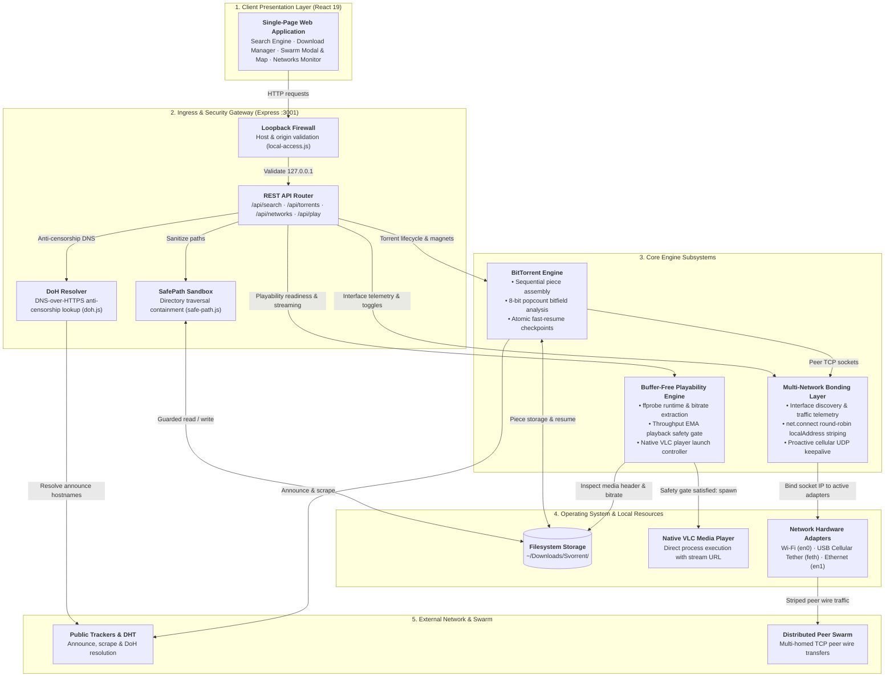

<p align="center">
  
</p>

<h1 align="center">Svorrent</h1>

<p align="center">
  <b>A desktop BitTorrent client with search, downloads, local media playback, and network and peer diagnostics.</b>
</p>

<p align="center">
  <a href="https://github.com/sovopr/svorrent/actions/workflows/ci.yml"></a>
  <a href="https://github.com/sovopr/svorrent/releases/latest"></a>
  <a href="https://github.com/sovopr/svorrent/releases"></a>
  <a href="LICENSE"></a>
</p>

---

## Downloads (v1.0.4)

Svorrent uses a local web interface. Desktop launchers start the backend and open the interface in your default browser. Node.js 22.12 or newer is required; the current packages do not bundle it.

| Platform | Package | Size | Description |
| :--- | :--- | :--- | :--- |
| **Windows (x64)** | [**`Svorrent-Setup.exe`**](https://github.com/sovopr/svorrent/releases/latest/download/Svorrent-Setup.exe) | Varies | Installer with Desktop & Start Menu shortcuts. |
| **macOS (Apple Silicon)** | [**`Svorrent.dmg`**](https://github.com/sovopr/svorrent/releases/latest/download/Svorrent.dmg) | Varies | Native Apple Silicon disk image. Drag `Svorrent.app` into `/Applications`. |

The macOS package is arm64-only; an Intel Mac build is not currently available.
These packages are free but not Developer ID notarized or Authenticode signed. macOS or Windows may warn or block them. Check the release's SHA256SUMS.txt before installing; automatic in-app updates are not available for unsigned builds.

---

## Features & Interface Workflow

### 1. Torrent Search
The search interface currently uses The Pirate Bay provider with a bounded request timeout.
- Queries are deduplicated, normalized, and sortable by seeds, leechers, file size, or indexer source.
- Magnets launch directly into the download pipeline with a single click.


### 2. Downloads Manager & Streaming Controls
The downloads dashboard manages active transfers and can open a playable local video in an installed media player.


#### 2.1 Sequential Piece Scheduling & Crash Recovery
- Forces sequential piece acquisition (from piece 0 to piece N) to enable immediate streaming instead of random piece distribution.
- Prioritizes container headers and initial chapters (first 25 MB and initial 20 pieces) with critical queue weighting.
- Atomic session snapshots store torrent metadata and verified-piece bitfields in `~/.svorrent/session.json` to accelerate resumption. Saves are batched; a crash can lose recent progress, and missing or changed files may require verification or re-downloading.
- Scans `~/Downloads/Svorrent` to detect orphaned files and halfway downloads, matching them to magnet hashes for one-click resumption.

#### 2.2 In-App Storage & File Deletion
- Custom in-app confirmation modal prevents accidental deletions.
- Option to remove torrent metadata only or permanently delete all associated files and downloaded folders from disk (`~/Downloads/Svorrent/`).
- Invalidation hooks immediately clear file scanner caches and purge persisted session checkpoints.

#### 2.3 Playback Readiness & Estimated Time to Play
Before enabling playback of an incomplete file, Svorrent continuously evaluates whether the remaining download can finish ahead of playback consumption:
$$\text{SafeDownloadedTarget} = \text{TotalLength} - \frac{\text{EffectiveSpeed} \times \text{Duration}}{\text{SafetyMargin}}$$

- **Dynamic Buffer Evaluation**: Computes the exact buffer required so playback never starves before the video finishes, incorporating container header validation and a 20% safety margin against connection fluctuations.
- **Estimated Time to Play on Hover**: Hovering over the Play button or buffering hint displays the estimated time until safe streaming begins (e.g. `Estimated time to play: ~35m (need 4.2 GB more buffer to stream smoothly)`).
- **Throughput Smoothing (EMA)**: Exponential moving average smoothing stabilizes the playability timer against momentary 1-second BitTorrent chunk writing dips.
- **Media Player Integration**: Once the buffer threshold passes, one-click launches the growing file in VLC or your system's default media player.

#### 2.4 Swarm Telemetry Matrix & Peer Inspector
Every download row includes an isolated Swarm button opening a per-torrent inspector with a dual-view switcher:


- **Piece Bitfield & Sequential Streaming Frontier**: Renders verified chunk blocks on disk alongside real-time download blocks and the sequential playback frontier cursor.
- **Swarm Piece Availability Heatmap**: Visualizes piece availability rarity across all connected peers from rare (<25%) to abundant (100%).
- **Multi-Interface Breakdown & Protocol Badging**: Inspects remote peer connections broken down by local physical adapter (Wi-Fi, USB Tether, Ethernet) with clear TCP vs. uTP (Micro Transport Protocol) and WebRTC badges.
- **Dynamic Interface Filtering**: Automatically collapses interface filter tabs to the active connection when only 1 adapter exists, surfacing multi-interface tabs only when $\ge 2$ physical interfaces are bonded.
- **Structured Peer Table with Clean Formatting**: IPv6 addresses are properly truncated with tooltips, preventing column collisions, while independent modal scrolling allows fluid inspection of large swarms.
- **Global GeoIP Topology (Secondary View)**: Toggle over to the interactive vector SVG world map plotting remote peer coordinates and country contributions via offline `geoip-lite`.

### 3. Multi-Network Pooling & Bandwidth Bonding
Svorrent can distribute outgoing peer connections across multiple local interfaces. Additional throughput depends on routing, independent uplinks, peer availability, and network conditions.


- **Combined Speed Pooling**: Wi-Fi, cellular tethering, Ethernet, and secondary USB adapters can contribute separate peer connections. Their nominal speeds describe potential capacity; actual torrent speed is not guaranteed to equal their sum.
- **Per-Connection Routing**: Svorrent binds outgoing TCP peer sockets to enabled adapters' local IP addresses. This spreads peer traffic across available interfaces to maximize aggregate throughput.
- **Harmonized Upload Telemetry**: Outgoing BitTorrent protocol messages (piece requests, HAVE notifications, keepalives) are attributed across active interfaces, keeping upload speeds and session counters synchronized with physical adapter egress.
- **iOS Hotspot UDP Keepalive**: Proactive background UDP heartbeats prevent iOS cellular hotspots from dropping during active peer connections.
- **Android USB Tethering (macOS)**: Native `svorrent-tetherd` service automatically manages RNDIS virtual interface binding and DHCP configuration.
- **Per-Adapter Controls & Live Telemetry**: Any interface in the pool can be enabled or disabled on the fly from the Networks dashboard, which displays real-time bandwidth balancing percentages, per-adapter sparklines, and session data counters.

#### iPhone USB tethering on macOS

Svorrent can use an iPhone's cellular connection only after macOS has established an **iPhone USB** network service with a usable IPv4 address and router. A self-assigned `169.254.x.x` address is not an internet connection; the Networks page marks it as needing DHCP and does not send torrent peers through it.

With Personal Hotspot enabled on the unlocked iPhone, connect a data-capable USB cable and accept the Trust/Allow prompts. In **System Settings → Network → iPhone USB**, turn off **Disable Unless Needed**, check that TCP/IP uses DHCP, and renew the DHCP lease. If the service remains attached to an old, inactive device, remove it, reconnect the iPhone, and add the iPhone USB service again. After macOS shows a usable address and router, click **Refresh adapters** in Svorrent and pause/resume the download to establish new peer connections on both networks. See [Apple's USB hotspot troubleshooting](https://support.apple.com/en-ie/119837) and [Plexo's network troubleshooting](https://github.com/anmolkapil/plexo#troubleshooting).

---

## Architecture

```
svorrent/
├── backend/
│   ├── server.js                # Express REST API and WebTorrent orchestration
│   ├── bin/                     # Native compiled daemons and shared libraries
│   │   ├── svorrent-tetherd     # Native background tethering daemon
│   │   ├── libtetherkit*.dylib  # TetherKit C ABI library and symlinks
│   │   └── libusb-1.0.0.dylib  # USB dependency
│   ├── tether/                  # C++ tether daemon source (RNDIS / libusb)
│   ├── lib/
│   │   ├── networks.js          # Multi-interface socket routing & upload attribution
│   │   ├── playability.js       # Buffer-free streaming math, EMA smoothing & ffprobe extraction
│   │   ├── session.js           # Atomic bitfield checkpointing and recovery
│   │   ├── scanner.js           # Directory scanner for orphaned and halfway files
│   │   ├── local-access.js      # Host firewall & loopback origin protection
│   │   ├── safe-path.js         # Directory traversal containment & path validation
│   │   ├── doh.js               # DNS-over-HTTPS anti-censorship lookup
│   │   ├── trackers.js          # Dynamic public tracker fallback lists
│   │   ├── archive.js           # Torrent metadata storage
│   │   └── torrents.js          # Shared lifecycle synchronization and magnet parsing
│   └── scripts/
│       ├── install-tetherd.sh   # Launchd service installer for macOS
│       ├── uninstall-tetherd.sh # Service uninstaller
│       └── e2e-local.js         # Loopback synthetic end-to-end integration test
├── frontend/
│   ├── src/
│   │   ├── App.jsx              # Navigation and global polling loop
│   │   ├── SearchPage.jsx       # Multi-tracker search query interface
│   │   ├── DownloadsManager.jsx # Download queue, action controls, and VLC triggers
│   │   ├── SwarmModal.jsx       # Swarm inspector, country charts, and peer table
│   │   ├── SwarmWorldMap.jsx    # SVG vector map with centroid peer plotting
│   │   ├── NetworksPage.jsx     # Network adapter status and traffic telemetry
│   │   ├── TorrentDetails.jsx   # Inspector for trackers, files, and bitfield pieces
│   │   ├── Icon.jsx             # Accessible vector icon rendering component
│   │   ├── countryUtils.js      # GeoIP country codes, names, and flag emojis
│   │   ├── useDialog.js         # Accessible modal dialog state hook
│   │   └── lib.js               # API client, units formatting, and speed calculations
│   └── package.json
└── scripts/
    ├── build-dmg.sh             # macOS .app bundle and compressed DMG builder
    ├── build-windows.sh         # Windows Win32 launcher, NSIS installer, and portable ZIP builder
    ├── launcher.c               # Native Win32 background daemon launcher (C/MinGW)
    ├── launcher.rc              # Windows icon resource & manifest definition
    ├── manifest.xml             # Windows DPI awareness and security application manifest
    └── installer.nsi            # Nullsoft NSIS installer configuration (LZMA solid compression)
```

---

## Getting Started from Source

### Prerequisites
- Node.js 22.12 or newer
- Optional: VLC Media Player (`/Applications/VLC.app` or `vlc` in PATH)
- Optional: `ffprobe` for container runtime extraction

### 1. Backend Setup

```bash
cd backend
npm ci
npm start
```

The API service runs on `http://localhost:3001`. Downloads are written to `~/Downloads/Svorrent/`.
For isolated local testing, `SVORRENT_DOWNLOAD_DIR` and `SVORRENT_DATA_DIR` can override those paths. Set `SVORRENT_DISABLE_PUBLIC_DISCOVERY=1` to disable DHT and bundled public trackers while retaining trackers supplied by a magnet link.
With `ffmpeg` installed, run `cd backend && npm run test:e2e` for a synthetic, loopback-only torrent transfer, player launch, and cleanup check. The test uses a temporary download folder and does not touch `~/Downloads/Svorrent`.
Run `cd frontend && npm run test:e2e` for isolated Chromium and WebKit UI tests, including a real loopback torrent download, SHA-256 verification, and deletion. Install both Playwright browsers with `npx playwright install chromium webkit` first. These tests use a temporary download folder.

### 2. Frontend Setup

```bash
cd frontend
npm ci
npm run dev
```

The interface runs on `http://localhost:5173`.

### 3. Packaging Releases

To build the production desktop distributions (approximately 10–21 MB):

```bash
# Build macOS .dmg (outputs to dist-app/Svorrent.dmg)
cd backend
npm run build:dmg

# Build Windows installer & portable zip (outputs to dist-win/)
cd backend
npm run build:win
```

Tagged public releases now publish free, clearly labelled unsigned packages after cross-platform tests. The macOS app has only an ad-hoc signature (no Developer ID notarization); the Windows installer has no Authenticode signature. Both may trigger platform security warnings, and in-app automatic updates remain unavailable without signed main builds. Verify the release checksums before installing. See [macOS signing](docs/releases/macos-signing.md), [Windows signing](docs/releases/windows-signing.md), and [dependency security](docs/dependency-security.md) if trusted distribution is added later.

---

## System Architecture

The following diagram details the interconnectivity between the client interface, backend coordination subsystems, kernel-level network binding, and external peer connections:



---

## Technical Specifications

| Component | Implementation |
| :--- | :--- |
| Core Protocol & Swarm | WebTorrent, P2P Wire Protocol, DHT |
| Desktop Architecture | Native Win32 / macOS browser-client launchers (~10–20 MB packages, zero Electron overhead) |
| Search Engine | Multi-provider aggregation with bounded timeouts & DoH anti-censorship shield |
| Network Routing & Bonding | Multi-interface OS socket binding, iOS hotspot UDP keepalive, and harmonized adapter upload attribution |
| Streaming Readiness Engine | ffprobe metadata extraction + dynamic buffer equation with EMA smoothing and hover ETA |
| Swarm Telemetry | Piece bitfield availability heatmap, interface breakdown, and interactive vector SVG map |
| Security & Sandboxing | Host loopback origin firewall, path traversal containment, and safe directory sandboxing |
| GeoIP Resolution | Offline MaxMind GeoLite database via geoip-lite |
| UI Framework | React 19, Vite, Vanilla CSS |

---

## License

MIT
